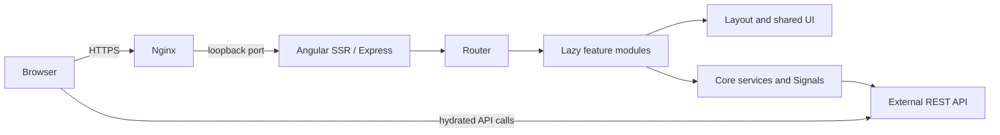

# Nexera Group Web Client

Angular 22 SSR frontend for the Nexera Group public website. It provides company, services, portfolio, and contact experiences. Portfolio data and contact submissions use an external Nexera API.

**Status:** Public pages, SSR, SEO assets, and web deployment configuration are present. Portfolio and contact submissions require the configured API.

## Overview

This repository contains the **frontend/client application only**. Angular renders it through an Express SSR server, then hydrates it in the browser. It does not contain the API, database, gateway, or control application.

- Lazy Home, About, Services, Portfolio, and Contact pages.
- SSR/prerendering; metadata, canonical URLs, Open Graph/Twitter metadata, JSON-LD, web manifest, sitemap, and robots files.
- Responsive header/footer/mobile navigation and persisted light/dark preferences.
- API-backed portfolio filtering and a validated, CSRF-aware contact form.

## Technology stack

| Area      | Implementation                                                             |
| --------- | -------------------------------------------------------------------------- |
| Framework | Angular 22 with NgModules and lazy feature modules                         |
| Rendering | Angular SSR, Express 5, hydration, prerendered server routes               |
| Data      | Angular HttpClient, functional interceptors, Signals, RxJS 7.8             |
| UI        | CSS custom-property tokens, responsive CSS, Font Awesome 7, Reactive Forms |
| Tooling   | TypeScript 6, Angular CLI 22, pnpm 12.3.4, Node 24, Prettier 3             |
| Realtime  | Socket.IO client 4.8 foundation; inactive in public environments           |
| Delivery  | Docker, Docker Compose, Nginx, GitHub Actions                              |

## Architecture

AppModule composes the shell. CoreModule.forRoot() configures API, auth, connection, storage, SEO, theme, and realtime services. Feature modules are lazy-loaded. The Node entry point serves browser assets, renders non-API routes with Angular SSR, and returns JSON 404 for /api when no reverse proxy has handled it.



Development /api/* calls use the Angular CLI proxy. Staging and production browser calls use their API subdomains directly; Nginx here proxies the web application, not those cross-origin API calls.

### Project structure

```text
src/app/
├── config/       # Injection-token configuration
├── core/         # API, auth, storage, SEO, theme, websocket, interceptors, guards
├── features/     # Home, About, Services, Portfolio, Contact
├── layout/       # Header, footer, main layout
└── shared/       # Button, input, loader, badge, alert
src/environments/ # Build-time dev, staging, prod settings
src/seo/          # Dev/staging no-index robots files
src/styles/       # Tokens, themes, base, responsive, utility CSS
public/           # Assets, manifest, production robots.txt, sitemap.xml
proxy/            # Angular CLI proxy configuration and tests
deploy/           # Compose, Nginx, deployment documentation
.github/workflows/ # Staging and production deployment workflows
```

## Prerequisites and installation

- Node.js >=24.15.0 and <25; .nvmrc specifies v24.21.0.
- pnpm 12.3.4 through Corepack.
- Docker Engine and Docker Compose for container workflows.

```bash
cd client
corepack enable
pnpm install --frozen-lockfile
pnpm start
```

The dev server listens on http://localhost:4200, binds to 0.0.0.0, and proxies /api/* to http://localhost:3300 by default.

## Environment configuration

Angular replaces src/environments/environment.ts during the build. These files contain public browser configuration, never secrets.

| Build   | Source                 | Public site                    | Browser API base                          | Indexing |
| ------- | ---------------------- | ------------------------------ | ----------------------------------------- | -------- |
| dev     | environment.dev.ts     | http://localhost:4200          | /api/v1                                   | Disabled |
| staging | environment.staging.ts | https://staging.nexeragroup.rw | https://staging-api.nexeragroup.rw/api/v1 | Disabled |
| prod    | environment.prod.ts    | https://nexeragroup.rw         | https://api.nexeragroup.rw/api/v1         | Enabled  |

Ignored .env.dev, .env.staging, and .env.prod configure the **CLI proxy only** and are not in the browser bundle. Shell values override file values.

| Variable                | Required                                                | Description                                                                                                |
| ----------------------- | ------------------------------------------------------- | ---------------------------------------------------------------------------------------------------------- |
| API_PROXY_TARGET        | Optional in dev; required for staging/prod CLI previews | HTTP(S) origin only, without credentials, path, query, or fragment. Dev defaults to http://localhost:3300. |
| API_PROXY_TIMEOUT_MS    | No                                                      | Integer from 1000 through 120000; default 30000.                                                           |
| API_PROXY_ALLOWED_HOSTS | No                                                      | Comma-separated upstream-host allow-list.                                                                  |

Staging/prod proxy files support local ng serve diagnostics only. Deployed builds use the absolute API URLs above.

## API, auth, and real-time integration

ApiService appends safe relative paths to the configured API base, rejects absolute URLs and traversal segments, and has a 15-second default timeout. Its interceptor adds Accept: application/json only for configured API requests; credentials are opt-in.

- PortfolioService requests GET /projects page by page and maps active technologies. It loads in the browser, so SSR does not fetch projects.
- ContactService requests GET /auth/csrf, then sends POST /inquiries with the returned X-XSRF-TOKEN header.
- ConnectionService polls /health/live while a tab is visible and exposes connectivity state with Signals.
- Error/loading interceptors emit safe ApplicationError messages and track global activity.

AuthStore retains session/access-token state in memory with Signals. authInterceptor adds a Bearer token only to configured API requests; eligible 401 responses share one raw /auth/refresh request with credentials and retry once. AuthSessionExpiryService clears the session and redirects to /login after terminal refresh failure.

The public route map has **no** login, protected, or permission-guarded route. authGuard, guestGuard, permissionGuard, and activeShiftGuard are available for future routes but are not wired into the public site. Frontend guards are not a security boundary; the API must enforce authorization and validation.

WebsocketService is a typed Socket.IO foundation. It uses the in-memory token during the handshake and restores requested branch rooms after reconnecting. No websocketBaseUrl is configured in public environments, and public routes do not establish a session, so realtime is inactive.

The API must enforce validation, authorization, CORS, and CSRF. Staging/production APIs must allow their exact web origin, including contact-form preflight requests.

## Routing, state, UI, and forms

| Route      | Feature   | Behavior                      |
| ---------- | --------- | ----------------------------- |
| /          | Home      | Public                        |
| /about     | About     | Public                        |
| /services  | Services  | Public                        |
| /portfolio | Portfolio | Public, API-backed in browser |
| /contact   | Contact   | Public, API submission        |
| **         | —         | Redirects to /                |

Routes are lazy-loaded, have title/SEO metadata, restore scroll position, and support anchors. Server routes are prerendered and hydrated for browser behavior.

There is no NgRx/Redux store. AuthStore, ThemeService, StorageService, and feature pages use Signals; RxJS handles HTTP and teardown. Storage is namespaced/versioned as default:v1 and supports TTL.

Global CSS imports tokens for color, typography, spacing, borders, shadows, motion, and z-index, then themes, base, responsive, and utility layers. The configured default is the monochrome default theme in system mode, with light/dark support. Blue and green definitions exist but are not the public default. Reusable UI is in shared/; the shell is in layout/.

The Contact page is a Reactive Form with required, email, and length validation. It is client-side feedback only; the API must validate and protect submissions independently.

## Commands

```bash
pnpm start
pnpm run start:dev
pnpm run watch

pnpm run build:dev
pnpm run build:staging
pnpm run build:prod

# After the corresponding build
pnpm run serve:dev:ssr
pnpm run serve:staging:ssr
pnpm run serve:prod:ssr
```

Artifacts are written to dist/client/<configuration>/ssr/, with browser/ and server/ directories. The server uses PORT or defaults to 4200. Staging/prod builds accept only their public host; test locally with the matching Host header or Nginx host.

`build:ssr` and `start:*:ssr` reference Angular `build-ssr`/`serve-ssr` targets not defined in angular.json. Do not use them: each `build:*` command already emits the SSR artifact consumed by `serve:*:ssr` and Docker.

## Docker and Nginx

The Dockerfile builds with Node 24.21 Alpine and pnpm --frozen-lockfile, then runs the generated Express server as the non-root node user on port 4200.

```bash
docker build --build-arg BUILD_CONFIGURATION=prod -t nexera-group-web:prod .
docker run --rm --name nexera-group-web -p 4200:4200 nexera-group-web:prod
curl -I -H 'Host: nexeragroup.rw' http://127.0.0.1:4200/

# From client/
docker compose --env-file deploy/.env.staging -f deploy/compose.staging.yml up -d --build
docker compose --env-file deploy/.env.prod -f deploy/compose.prod.yml up -d --build
```

| Environment | Domain                 | Container                | Private host port | Container port |
| ----------- | ---------------------- | ------------------------ | ----------------- | -------------- |
| Staging     | staging.nexeragroup.rw | nexera-group-web-staging | 127.0.0.1:10111   | 4200           |
| Production  | nexeragroup.rw         | nexera-group-web-prod    | 127.0.0.1:10101   | 4200           |

Nginx terminates TLS and proxies each public host to its loopback port. Production redirects www.nexeragroup.rw to nexeragroup.rw. The supplied files set TLS 1.2/1.3, X-Content-Type-Options, Referrer-Policy, and X-Frame-Options; production also sets HSTS. Follow [deploy/README.md](deploy/README.md) to install host configuration/certificates, validate with nginx -t, then reload.

deploy/nginx/api-locations.conf is an optional same-origin API-proxy snippet. It is not included by the web virtual hosts because deployed browser configuration uses dedicated API subdomains.

## Testing and code quality

```bash
pnpm run test:proxy
pnpm run test:proxy:integration
pnpm test -- --watch=false
pnpm exec prettier --check .
```

test:proxy covers proxy boundaries, upstream validation, timeouts, and sanitized failures. test:proxy:integration starts temporary local servers and needs permission to bind ports. The Angular unit-test command uses Angular and Vitest dependencies, but its component/test setup needs repair before it can be a release gate. No E2E, coverage, lint, or standalone type-check script is configured.

TypeScript enables noImplicitReturns, noImplicitOverride, noPropertyAccessFromIndexSignature, noFallthroughCasesInSwitch, isolated modules, and strict Angular dependency/input checks. The global TypeScript strict option is not enabled.

## CI/CD and deployment

| Workflow           | Trigger                               | Environment | Target root                     |
| ------------------ | ------------------------------------- | ----------- | ------------------------------- |
| deploy-staging.yml | Push to staging or manual dispatch    | staging     | /home/yves/nexera-group/staging |
| deploy-prod.yml    | Push to production or manual dispatch | production  | /home/yves/nexera-group/prod    |

Each workflow configures SSH from environment-scoped secrets, creates web/logs/data folders, synchronizes the client, and runs matching Docker Compose. Docker runs the Angular environment build. These workflows do not run separate tests/lint and do not install Nginx or certificates.

Each GitHub environment needs DEPLOY_HOST, DEPLOY_USER, DEPLOY_PORT, DEPLOY_SSH_KEY, and DEPLOY_KNOWN_HOSTS. Do not commit their values. Client deployment creates only web, logs, and data; Control, API/Server, and Gateway are out of scope.

## Security notes

- API paths are constrained to the configured base URL; auth/API defaults are not applied to arbitrary external URLs.
- Access tokens remain in the in-memory AuthStore; refresh is designed for an HttpOnly cookie.
- Contact submission explicitly obtains a CSRF token; cross-origin API CORS/cookie/CSRF settings remain API responsibilities.
- SSR host allow-lists, a non-root container, loopback-only Compose bindings, and listed Nginx headers are implemented.
- No Content-Security-Policy is configured in the supplied Nginx files. Add and test one before relying on it as a security control.
- The API remains responsible for authorization, validation, rate limits, and abuse prevention.

## Browser support

No Browserslist or explicit browser-support policy is configured. Test the browsers required by the product before publishing a compatibility commitment.

## Troubleshooting

```bash
# Find a process using the development port
lsof -nP -iTCP:4200 -sTCP:LISTEN

# Test the development API route through the CLI proxy
curl -i http://localhost:4200/api/v1/health/live

# Inspect a production Compose deployment
docker compose --env-file deploy/.env.prod -f deploy/compose.prod.yml ps
docker compose --env-file deploy/.env.prod -f deploy/compose.prod.yml logs -f web
```

For a different local API, set API_PROXY_TARGET to an origin only, such as http://127.0.0.1:3300, then restart pnpm start. Do not append /api/v1.

For staging/production contact failures, verify API TLS, exact CORS allow-list, OPTIONS handling, credentials policy, and CSRF contract. The CLI proxy is not used by deployed browser requests. A local staging/prod SSR response of 400 means the Host header must be staging.nexeragroup.rw or nexeragroup.rw, or be supplied through the matching Nginx virtual host.

## Maintainer workflow

Use pnpm and the matching environment build. Update route metadata, sitemap, and public assets together when adding a public page. Before merging deployment work, run relevant build/proxy tests, review SSR output, and validate Nginx on the target host. Verified deployment branches are staging and production; no broader contribution convention is configured.

## License

No license file is present in this repository.
